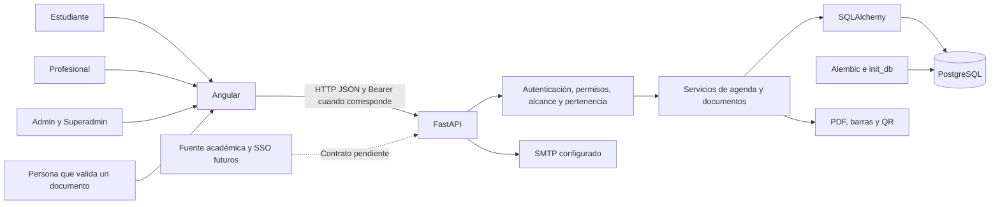
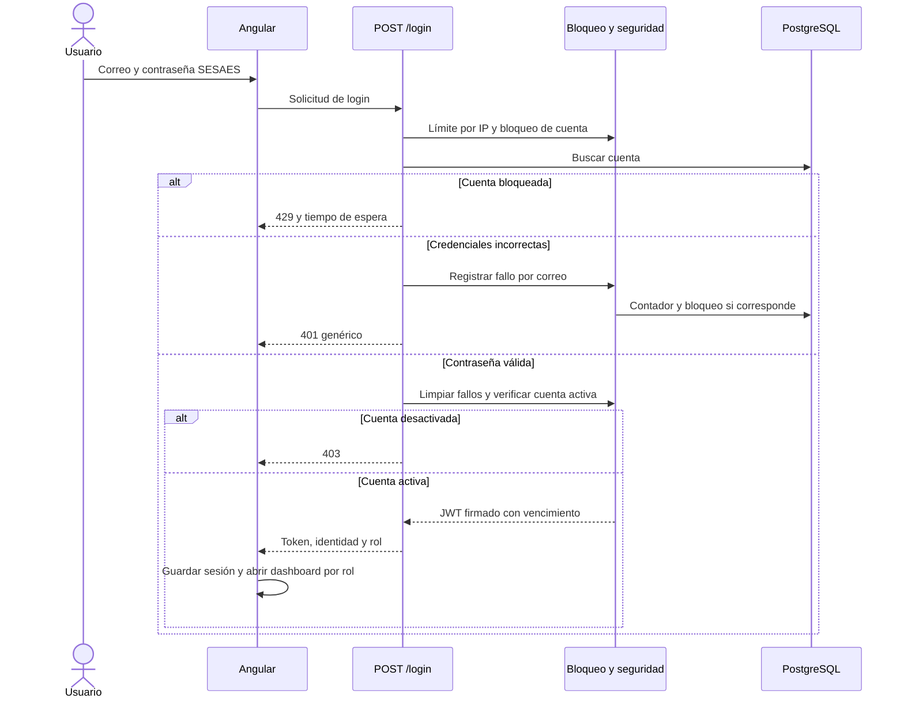
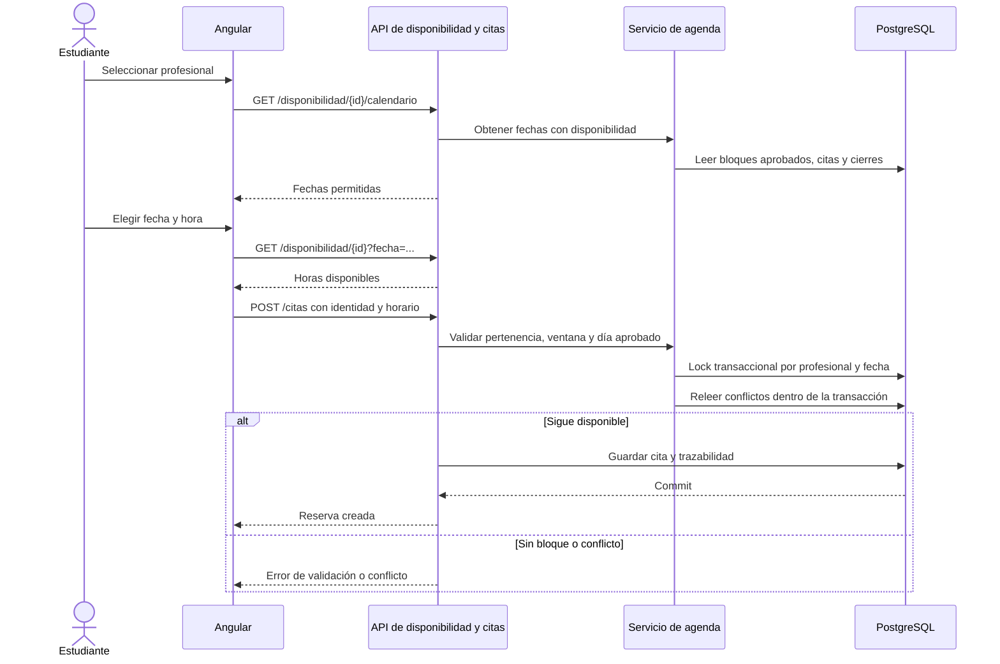
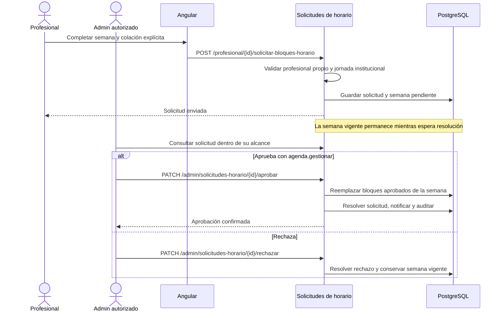
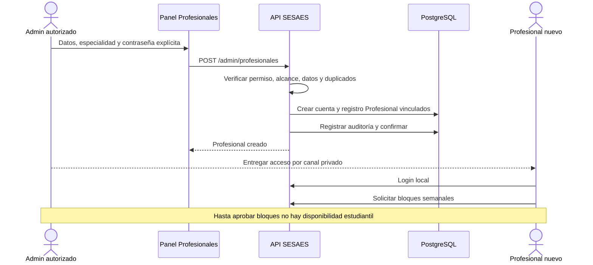
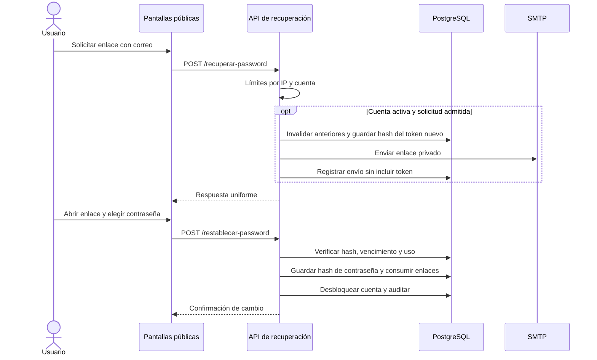
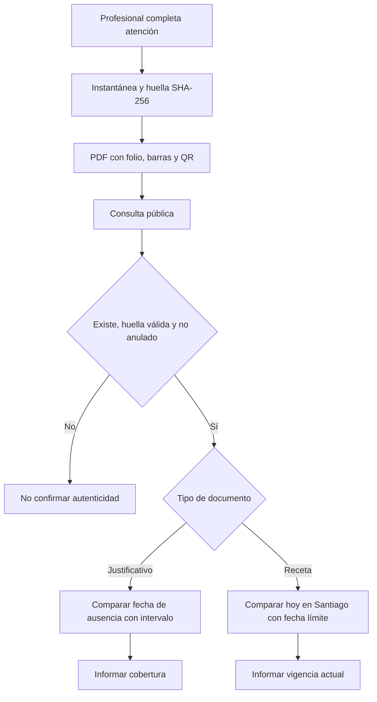
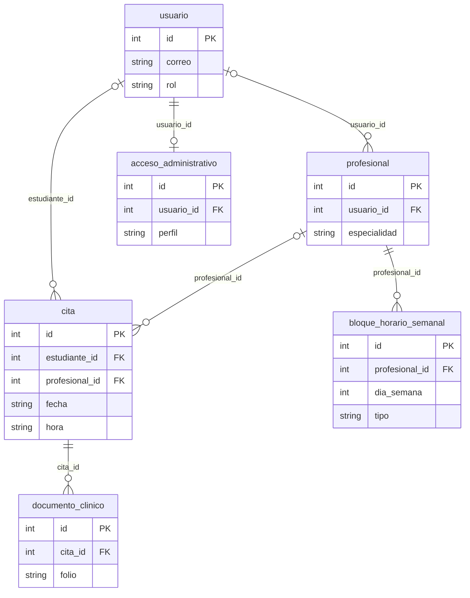

# Diagramas de SESAES

Los bloques Mermaid se pueden visualizar en GitHub y en editores compatibles.
Representan la versión integrada, no una conexión institucional futura.
El ER físico completo está en [MODELO_DATOS](MODELO_DATOS.md).

## 1. Arquitectura y límites de confianza

El frontend no accede directamente a PostgreSQL. El enlace punteado es una
integración propuesta, no un servicio conectado.

## 2. Login local

Esto no representa SSO ni acredita matrícula.

## 3. Reservar una cita como estudiante

Consultar una hora no la bloquea mientras el usuario completa el formulario.
El servidor vuelve a comprobarla al crear.

## 4. Solicitar y aprobar bloques semanales

La aprobación no mueve automáticamente citas existentes. Antes de cambiar la
semana, administración debe revisar las reservas afectadas.

## 5. Alta de profesional y habilitación de agenda

Usuario.id es la identidad de acceso; Profesional.id identifica la agenda.
No deben intercambiarse aunque en una base de prueba tengan el mismo número.

## 6. Recuperar contraseña

SMTP real debe configurarse; las pruebas automatizadas simulan el envío.

## 7. Documento auténtico y período de uso

Validar no equivale a registrar una entrega de medicamentos ni a comprobar
la matrícula del estudiante.

## 8. ER de lectura rápida

Este extracto usa las claves del esquema físico y permite ubicar las entidades
centrales. Las tablas restantes, columnas, índices y restricciones están en
[MODELO_DATOS](MODELO_DATOS.md), que incluye el ER completo.

La relación física no sustituye las reglas de pertenencia. Un admin tampoco
adquiere permiso clínico por aparecer relacionado con el mismo sistema.
