# Modelo de datos

Referencia del esquema objetivo de SQLAlchemy en la versión integrada.
Generada desde los metadatos, sin conectarse a una base ni leer datos de usuarios.
Head: 8d2e4f6a901b. Las 28 tablas de dominio no incluyen alembic_version.

## Convenciones

- PK: clave primaria. FK: clave foránea.
- Nullable indica si el esquema permite NULL; no reemplaza validación de API.
- Un default de aplicación se aplica mediante SQLAlchemy; no es siempre un default SQL.
- El estudiante es una fila de usuario con rol estudiante; no existe tabla estudiante.
- Usuario y Profesional tienen identidades distintas.
- La autenticación de recuperación usa timestamps aware; existen fechas históricas sin zona.

## Relaciones físicas

El gráfico refleja claves foráneas declaradas. No inventa una asignación clínica universal.
Un identificador de auditoría sin FK sigue siendo referencia lógica y se documenta en sus columnas.

```mermaid
erDiagram
    acceso_admin_especialidad {
        int id PK
        int acceso_admin_id FK
    }
    acceso_admin_permiso {
        int id PK
        int acceso_admin_id FK
    }
    acceso_administrativo {
        int id PK
        int usuario_id FK
    }
    auditoria {
        int id PK
        int usuario_id FK
    }
    bloque_horario_semanal {
        int id PK
        int profesional_id FK
    }
    cita {
        int id PK
        int estudiante_id FK
        int profesional_id FK
        int creado_por_usuario_id FK
    }
    cita_sobrecupo {
        int id PK
        int cita_id FK
    }
    cita_sobrecupo_conflicto {
        int id PK
        int cita_sobrecupo_id FK
    }
    configuracion_centro {
        int id PK
    }
    configuracion_sistema {
        int id PK
    }
    correo_log {
        int id PK
    }
    cuestionario_config {
        int profesional_id PK, FK
    }
    cuestionario_envio {
        int id PK
        int profesional_id FK
        int estudiante_id FK
    }
    dia_cerrado {
        int id PK
        int creado_por FK
    }
    documento_clinico {
        int id PK
        int cita_id FK
        int profesional_id FK
        int estudiante_id FK
    }
    especialidad_capability {
        int id PK
    }
    firma_profesional {
        int id PK
        int profesional_id FK
    }
    historial_estado_profesional {
        int id PK
        int profesional_id FK
        int registrado_por FK
    }
    historial_paciente {
        int id PK
        int profesional_id FK
        int estudiante_id FK
    }
    historial_plantilla_pregunta {
        int id PK
    }
    horario_disponible {
        int id PK
        int profesional_id FK
    }
    intento_login {
        int id PK
    }
    notificacion {
        int id PK
        int usuario_id FK
    }
    profesional {
        int id PK
        int usuario_id FK
    }
    restablecimiento_password {
        int id PK
        int usuario_id FK
    }
    solicitud_horario {
        int id PK
        int profesional_id FK
    }
    solicitud_horario_bloques {
        int solicitud_id PK, FK
    }
    usuario {
        int id PK
    }
    acceso_administrativo ||--o{ acceso_admin_especialidad : "acceso_admin_id"
    acceso_administrativo ||--o{ acceso_admin_permiso : "acceso_admin_id"
    usuario ||--o| acceso_administrativo : "usuario_id"
    usuario o|--o{ auditoria : "usuario_id"
    profesional ||--o{ bloque_horario_semanal : "profesional_id"
    usuario o|--o{ cita : "estudiante_id"
    profesional o|--o{ cita : "profesional_id"
    usuario o|--o{ cita : "creado_por_usuario_id"
    cita ||--o| cita_sobrecupo : "cita_id"
    cita_sobrecupo ||--o{ cita_sobrecupo_conflicto : "cita_sobrecupo_id"
    profesional ||--o{ cuestionario_config : "profesional_id"
    profesional ||--o{ cuestionario_envio : "profesional_id"
    usuario ||--o{ cuestionario_envio : "estudiante_id"
    usuario o|--o{ dia_cerrado : "creado_por"
    cita ||--o{ documento_clinico : "cita_id"
    profesional ||--o{ documento_clinico : "profesional_id"
    usuario ||--o{ documento_clinico : "estudiante_id"
    profesional ||--o| firma_profesional : "profesional_id"
    profesional o|--o{ historial_estado_profesional : "profesional_id"
    usuario o|--o{ historial_estado_profesional : "registrado_por"
    profesional ||--o{ historial_paciente : "profesional_id"
    usuario ||--o{ historial_paciente : "estudiante_id"
    profesional o|--o{ horario_disponible : "profesional_id"
    usuario o|--o{ notificacion : "usuario_id"
    usuario o|--o{ profesional : "usuario_id"
    usuario ||--o{ restablecimiento_password : "usuario_id"
    profesional ||--o{ solicitud_horario : "profesional_id"
    solicitud_horario ||--o{ solicitud_horario_bloques : "solicitud_id"
```

## Diccionario de tablas

### acceso_admin_especialidad

| Columna                  | Tipo SQLAlchemy | Clave                         | Nullable | Default |
| ------------------------ | --------------- | ----------------------------- | -------- | ------- |
| id                       | INTEGER         | PK                            | No       | —       |
| acceso_admin_id          | INTEGER         | FK → acceso_administrativo.id | No       | —       |
| especialidad             | VARCHAR(160)    | —                             | No       | —       |
| especialidad_normalizada | VARCHAR(160)    | —                             | No       | —       |

Restricciones adicionales:

- ck_acceso_admin_especialidad_nombre_no_vacio: length(trim(especialidad)) > 0.
- uq_acceso_admin_especialidad_normalizada: acceso_admin_id, especialidad_normalizada.
- ck_acceso_admin_especialidad_normalizada_no_vacia: length(trim(especialidad_normalizada)) > 0.

### acceso_admin_permiso

| Columna         | Tipo SQLAlchemy | Clave                         | Nullable | Default |
| --------------- | --------------- | ----------------------------- | -------- | ------- |
| id              | INTEGER         | PK                            | No       | —       |
| acceso_admin_id | INTEGER         | FK → acceso_administrativo.id | No       | —       |
| permiso         | VARCHAR(96)     | —                             | No       | —       |

Restricciones adicionales:

- uq_acceso_admin_permiso: acceso_admin_id, permiso.
- ck_acceso_admin_permiso_valido: permiso IN ('usuarios.ver', 'usuarios.gestionar', 'profesionales.ver', 'profesionales.gestionar', 'agenda.ver', 'agenda.gestionar', 'agenda.sobrecupo', 'reportes.ver').

### acceso_administrativo

| Columna      | Tipo SQLAlchemy | Clave           | Nullable | Default |
| ------------ | --------------- | --------------- | -------- | ------- |
| id           | INTEGER         | PK              | No       | —       |
| usuario_id   | INTEGER         | FK → usuario.id | No       | —       |
| perfil       | VARCHAR(64)     | —               | No       | —       |
| tipo_alcance | VARCHAR(32)     | —               | No       | —       |

Restricciones adicionales:

- uq_acceso_administrativo_usuario: usuario_id.
- ck_acceso_administrativo_tipo_alcance: tipo_alcance IN ('institucional', 'especialidades').
- ck_acceso_administrativo_perfil: perfil IN ('administrador_general', 'administrador_especialidad', 'secretaria_general', 'secretaria_especialidad').
- ck_acceso_administrativo_perfil_alcance: (perfil IN ('administrador_general', 'secretaria_general') AND tipo_alcance = 'institucional') OR (perfil IN ('administrador_especialidad', 'secretaria_especialidad') AND tipo_alcance = 'especialidades').

### auditoria

| Columna    | Tipo SQLAlchemy | Clave           | Nullable | Default    |
| ---------- | --------------- | --------------- | -------- | ---------- |
| id         | INTEGER         | PK              | No       | —          |
| usuario_id | INTEGER         | FK → usuario.id | Sí       | —          |
| actor_rol  | VARCHAR         | —               | Sí       | —          |
| accion     | VARCHAR         | —               | Sí       | —          |
| resultado  | VARCHAR         | —               | No       | SQL: exito |
| detalle    | VARCHAR         | —               | Sí       | —          |
| entidad    | VARCHAR         | —               | Sí       | —          |
| entidad_id | INTEGER         | —               | Sí       | —          |
| fecha      | DATETIME        | —               | Sí       | SQL: now() |

Índices:

- ix_auditoria_entidad_entidad_id_fecha (entidad, entidad_id, fecha).
- ix_auditoria_id (id).

### bloque_horario_semanal

| Columna        | Tipo SQLAlchemy | Clave               | Nullable | Default                |
| -------------- | --------------- | ------------------- | -------- | ---------------------- |
| id             | INTEGER         | PK                  | No       | —                      |
| profesional_id | INTEGER         | FK → profesional.id | No       | —                      |
| dia_semana     | INTEGER         | —                   | No       | —                      |
| hora_inicio    | VARCHAR         | —                   | No       | —                      |
| hora_fin       | VARCHAR         | —                   | No       | —                      |
| tipo           | VARCHAR         | —                   | No       | Aplicación: disponible |

Índices:

- ix_bloque_horario_semanal_id (id).
- ix_bloque_horario_semanal_profesional_id (profesional_id).

### cita

| Columna                | Tipo SQLAlchemy | Clave               | Nullable | Default               |
| ---------------------- | --------------- | ------------------- | -------- | --------------------- |
| id                     | INTEGER         | PK                  | No       | —                     |
| estudiante_id          | INTEGER         | FK → usuario.id     | Sí       | —                     |
| profesional_id         | INTEGER         | FK → profesional.id | Sí       | —                     |
| fecha                  | VARCHAR         | —                   | Sí       | —                     |
| hora                   | VARCHAR         | —                   | Sí       | —                     |
| estado                 | VARCHAR         | —                   | Sí       | Aplicación: pendiente |
| observaciones          | VARCHAR         | —                   | Sí       | —                     |
| urgente                | BOOLEAN         | —                   | Sí       | Aplicación: False     |
| cancelada_por_admin    | BOOLEAN         | —                   | Sí       | Aplicación: False     |
| motivo_cancelacion     | VARCHAR         | —                   | Sí       | —                     |
| medicamento            | VARCHAR         | —                   | Sí       | —                     |
| observaciones_atencion | VARCHAR         | —                   | Sí       | —                     |
| sobrecupo              | BOOLEAN         | —                   | Sí       | Aplicación: False     |
| creado_por_usuario_id  | INTEGER         | FK → usuario.id     | Sí       | —                     |
| creado_por_rol         | VARCHAR         | —                   | Sí       | —                     |
| creado_por_perfil      | VARCHAR         | —                   | Sí       | —                     |
| fecha_creacion         | DATETIME        | —                   | Sí       | SQL: now()            |

Índices:

- ix_cita_creado_por_usuario_id (creado_por_usuario_id).
- ix_cita_id (id).
- ix_cita_profesional_fecha_estado (profesional_id, fecha, estado).

### cita_sobrecupo

| Columna         | Tipo SQLAlchemy | Clave               | Nullable | Default    |
| --------------- | --------------- | ------------------- | -------- | ---------- |
| id              | INTEGER         | PK                  | No       | —          |
| cita_id         | INTEGER         | FK → cita.id; Única | No       | —          |
| motivo          | VARCHAR         | —                   | Sí       | —          |
| fecha_creacion  | DATETIME        | —                   | No       | SQL: now() |
| estado_revision | VARCHAR         | —                   | Sí       | —          |

Índices:

- ix_cita_sobrecupo_id (id).

Restricciones adicionales:

- UniqueConstraint: cita_id.

### cita_sobrecupo_conflicto

| Columna           | Tipo SQLAlchemy | Clave                  | Nullable | Default |
| ----------------- | --------------- | ---------------------- | -------- | ------- |
| id                | INTEGER         | PK                     | No       | —       |
| cita_sobrecupo_id | INTEGER         | FK → cita_sobrecupo.id | No       | —       |
| codigo            | VARCHAR         | —                      | No       | —       |

Índices:

- ix_cita_sobrecupo_conflicto_cita_sobrecupo_id (cita_sobrecupo_id).
- ix_cita_sobrecupo_conflicto_id (id).

### configuracion_centro

| Columna          | Tipo SQLAlchemy | Clave | Nullable | Default                                       |
| ---------------- | --------------- | ----- | -------- | --------------------------------------------- |
| id               | INTEGER         | PK    | No       | —                                             |
| nombre_centro    | VARCHAR         | —     | Sí       | Aplicación: SESAES                            |
| direccion        | VARCHAR         | —     | Sí       | Aplicación: José Pedro Alessandri 1200, Ñuñoa |
| telefono         | VARCHAR         | —     | Sí       | Aplicación:                                   |
| correo_contacto  | VARCHAR         | —     | Sí       | Aplicación:                                   |
| horario_atencion | VARCHAR         | —     | Sí       | Aplicación: Lunes a Viernes 08:00–18:00       |
| foto_admin_url   | VARCHAR         | —     | Sí       | —                                             |
| nombre_admin     | VARCHAR         | —     | Sí       | Aplicación: Admin SESAES                      |

Índices:

- ix_configuracion_centro_id (id).

### configuracion_sistema

| Columna                    | Tipo SQLAlchemy | Clave | Nullable | Default           |
| -------------------------- | --------------- | ----- | -------- | ----------------- |
| id                         | INTEGER         | PK    | No       | —                 |
| duracion_turno_min         | INTEGER         | —     | Sí       | Aplicación: 20    |
| agendamiento_por_pacientes | BOOLEAN         | —     | Sí       | Aplicación: True  |
| cancelacion_instantanea    | BOOLEAN         | —     | Sí       | Aplicación: False |
| sobreturnos_habilitados    | BOOLEAN         | —     | Sí       | Aplicación: True  |
| cupos_por_turno            | INTEGER         | —     | Sí       | Aplicación: 4     |

Índices:

- ix_configuracion_sistema_id (id).

### correo_log

| Columna       | Tipo SQLAlchemy | Clave | Nullable | Default           |
| ------------- | --------------- | ----- | -------- | ----------------- |
| id            | INTEGER         | PK    | No       | —                 |
| destinatario  | VARCHAR         | —     | Sí       | —                 |
| asunto        | VARCHAR         | —     | Sí       | —                 |
| cuerpo        | VARCHAR         | —     | Sí       | —                 |
| enviado       | BOOLEAN         | —     | Sí       | Aplicación: False |
| error_envio   | VARCHAR         | —     | Sí       | —                 |
| fecha         | DATETIME        | —     | Sí       | SQL: now()        |
| tipo          | VARCHAR         | —     | Sí       | —                 |
| referencia_id | INTEGER         | —     | Sí       | —                 |

Índices:

- ix_correo_log_id (id).

### cuestionario_config

| Columna            | Tipo SQLAlchemy | Clave                   | Nullable | Default           |
| ------------------ | --------------- | ----------------------- | -------- | ----------------- |
| profesional_id     | INTEGER         | PK; FK → profesional.id | No       | —                 |
| enviar_por_defecto | BOOLEAN         | —                       | No       | Aplicación: False |

### cuestionario_envio

| Columna        | Tipo SQLAlchemy | Clave               | Nullable | Default          |
| -------------- | --------------- | ------------------- | -------- | ---------------- |
| id             | INTEGER         | PK                  | No       | —                |
| profesional_id | INTEGER         | FK → profesional.id | No       | —                |
| estudiante_id  | INTEGER         | FK → usuario.id     | No       | —                |
| solicitado     | BOOLEAN         | —                   | No       | Aplicación: True |
| decidido_en    | DATETIME        | —                   | Sí       | SQL: now()       |

Índices:

- ix_cuestionario_envio_estudiante_id (estudiante_id).
- ix_cuestionario_envio_id (id).
- ix_cuestionario_envio_profesional_id (profesional_id).

Restricciones adicionales:

- uq_cuestionario_envio_par: profesional_id, estudiante_id.

### dia_cerrado

| Columna        | Tipo SQLAlchemy | Clave           | Nullable | Default    |
| -------------- | --------------- | --------------- | -------- | ---------- |
| id             | INTEGER         | PK              | No       | —          |
| fecha          | VARCHAR         | Única           | No       | —          |
| motivo         | VARCHAR         | —               | Sí       | —          |
| creado_por     | INTEGER         | FK → usuario.id | Sí       | —          |
| fecha_creacion | DATETIME        | —               | Sí       | SQL: now() |

Índices:

- ix_dia_cerrado_fecha (fecha) — único.
- ix_dia_cerrado_id (id).

### documento_clinico

| Columna          | Tipo SQLAlchemy | Clave               | Nullable | Default             |
| ---------------- | --------------- | ------------------- | -------- | ------------------- |
| id               | INTEGER         | PK                  | No       | —                   |
| tipo             | VARCHAR         | —                   | No       | —                   |
| folio            | VARCHAR         | Única               | No       | —                   |
| cita_id          | INTEGER         | FK → cita.id        | No       | —                   |
| profesional_id   | INTEGER         | FK → profesional.id | No       | —                   |
| estudiante_id    | INTEGER         | FK → usuario.id     | No       | —                   |
| contenido        | JSON            | —                   | No       | —                   |
| huella_sha256    | VARCHAR(64)     | —                   | No       | —                   |
| estado           | VARCHAR         | —                   | No       | Aplicación: vigente |
| motivo_anulacion | VARCHAR         | —                   | Sí       | —                   |
| emitido_en       | DATETIME        | —                   | Sí       | SQL: now()          |
| anulado_en       | DATETIME        | —                   | Sí       | —                   |

Índices:

- ix_documento_clinico_cita_id (cita_id).
- ix_documento_clinico_estudiante_id (estudiante_id).
- ix_documento_clinico_folio (folio) — único.
- ix_documento_clinico_id (id).
- ix_documento_clinico_profesional_id (profesional_id).

### especialidad_capability

| Columna                  | Tipo SQLAlchemy | Clave | Nullable | Default    |
| ------------------------ | --------------- | ----- | -------- | ---------- |
| id                       | INTEGER         | PK    | No       | —          |
| especialidad_normalizada | VARCHAR         | —     | No       | —          |
| capability               | VARCHAR         | —     | No       | —          |
| activo                   | BOOLEAN         | —     | No       | —          |
| creado_en                | DATETIME        | —     | Sí       | SQL: now() |

Índices:

- ix_especialidad_capability_especialidad_normalizada (especialidad_normalizada).
- ix_especialidad_capability_id (id).

Restricciones adicionales:

- uq_especialidad_capability_regla: especialidad_normalizada, capability.

### firma_profesional

| Columna        | Tipo SQLAlchemy | Clave                      | Nullable | Default    |
| -------------- | --------------- | -------------------------- | -------- | ---------- |
| id             | INTEGER         | PK                         | No       | —          |
| profesional_id | INTEGER         | FK → profesional.id; Única | No       | —          |
| imagen         | TEXT            | —                          | No       | —          |
| metodo         | VARCHAR         | —                          | No       | —          |
| actualizada_en | DATETIME        | —                          | Sí       | SQL: now() |

Índices:

- ix_firma_profesional_id (id).
- ix_firma_profesional_profesional_id (profesional_id) — único.

### historial_estado_profesional

| Columna         | Tipo SQLAlchemy | Clave               | Nullable | Default                 |
| --------------- | --------------- | ------------------- | -------- | ----------------------- |
| id              | INTEGER         | PK                  | No       | —                       |
| profesional_id  | INTEGER         | FK → profesional.id | Sí       | —                       |
| estado_anterior | VARCHAR         | —                   | Sí       | —                       |
| estado_nuevo    | VARCHAR         | —                   | Sí       | —                       |
| motivo          | VARCHAR         | —                   | Sí       | —                       |
| fecha           | DATETIME        | —                   | Sí       | Aplicación: ahora_local |
| registrado_por  | INTEGER         | FK → usuario.id     | Sí       | —                       |

Índices:

- ix_historial_estado_profesional_id (id).

### historial_paciente

| Columna                  | Tipo SQLAlchemy | Clave               | Nullable | Default           |
| ------------------------ | --------------- | ------------------- | -------- | ----------------- |
| id                       | INTEGER         | PK                  | No       | —                 |
| profesional_id           | INTEGER         | FK → profesional.id | No       | —                 |
| estudiante_id            | INTEGER         | FK → usuario.id     | No       | —                 |
| respuestas               | JSON            | —                   | Sí       | Aplicación: dict  |
| completado_por           | VARCHAR         | —                   | Sí       | —                 |
| revisado_por_profesional | BOOLEAN         | —                   | No       | Aplicación: False |
| fecha_creacion           | DATETIME        | —                   | Sí       | SQL: now()        |
| fecha_modificacion       | DATETIME        | —                   | Sí       | SQL: now()        |

Índices:

- ix_historial_paciente_estudiante_id (estudiante_id).
- ix_historial_paciente_id (id).
- ix_historial_paciente_profesional_id (profesional_id).

Restricciones adicionales:

- uq_historial_paciente_par: profesional_id, estudiante_id.

### historial_plantilla_pregunta

| Columna        | Tipo SQLAlchemy | Clave | Nullable | Default           |
| -------------- | --------------- | ----- | -------- | ----------------- |
| id             | INTEGER         | PK    | No       | —                 |
| profesional_id | INTEGER         | —     | Sí       | —                 |
| especialidad   | VARCHAR         | —     | No       | —                 |
| etiqueta       | VARCHAR         | —     | No       | —                 |
| tipo           | VARCHAR         | —     | Sí       | Aplicación: texto |
| orden          | INTEGER         | —     | Sí       | Aplicación: 0     |
| activa         | BOOLEAN         | —     | Sí       | Aplicación: True  |

Índices:

- ix_historial_plantilla_pregunta_especialidad (especialidad).
- ix_historial_plantilla_pregunta_id (id).
- ix_historial_plantilla_pregunta_profesional_id (profesional_id).

### horario_disponible

| Columna        | Tipo SQLAlchemy | Clave               | Nullable | Default                |
| -------------- | --------------- | ------------------- | -------- | ---------------------- |
| id             | INTEGER         | PK                  | No       | —                      |
| profesional_id | INTEGER         | FK → profesional.id | Sí       | —                      |
| dia_nombre     | VARCHAR         | —                   | Sí       | —                      |
| dia_num        | INTEGER         | —                   | Sí       | —                      |
| fecha          | VARCHAR         | —                   | Sí       | —                      |
| hora           | VARCHAR         | —                   | Sí       | —                      |
| estado         | VARCHAR         | —                   | Sí       | Aplicación: disponible |

Índices:

- ix_horario_disponible_id (id).

### intento_login

| Columna         | Tipo SQLAlchemy | Clave | Nullable | Default       |
| --------------- | --------------- | ----- | -------- | ------------- |
| id              | INTEGER         | PK    | No       | —             |
| correo          | VARCHAR         | Única | No       | —             |
| fallidos        | INTEGER         | —     | No       | Aplicación: 0 |
| bloqueado_hasta | DATETIME        | —     | Sí       | —             |
| actualizado_en  | DATETIME        | —     | No       | —             |

Índices:

- ix_intento_login_correo (correo) — único.
- ix_intento_login_id (id).

### notificacion

| Columna        | Tipo SQLAlchemy | Clave           | Nullable | Default                 |
| -------------- | --------------- | --------------- | -------- | ----------------------- |
| id             | INTEGER         | PK              | No       | —                       |
| usuario_id     | INTEGER         | FK → usuario.id | Sí       | —                       |
| mensaje        | VARCHAR         | —               | Sí       | —                       |
| tipo           | VARCHAR         | —               | Sí       | —                       |
| leida          | BOOLEAN         | —               | Sí       | Aplicación: False       |
| fecha_creacion | DATETIME        | —               | Sí       | Aplicación: ahora_local |

Índices:

- ix_notificacion_id (id).

### profesional

| Columna              | Tipo SQLAlchemy | Clave           | Nullable | Default            |
| -------------------- | --------------- | --------------- | -------- | ------------------ |
| id                   | INTEGER         | PK              | No       | —                  |
| nombre               | VARCHAR         | —               | Sí       | —                  |
| tratamiento          | VARCHAR         | —               | Sí       | —                  |
| color_identificador  | VARCHAR         | —               | Sí       | —                  |
| especialidad         | VARCHAR         | —               | Sí       | —                  |
| iniciales            | VARCHAR(5)      | —               | Sí       | —                  |
| descripcion          | VARCHAR         | —               | Sí       | —                  |
| usuario_id           | INTEGER         | FK → usuario.id | Sí       | —                  |
| duracion_min         | INTEGER         | —               | Sí       | Aplicación: 45     |
| estado               | VARCHAR         | —               | Sí       | Aplicación: activo |
| correo               | VARCHAR         | —               | Sí       | —                  |
| rut                  | VARCHAR         | —               | Sí       | —                  |
| foto_url             | VARCHAR         | —               | Sí       | —                  |
| hora_almuerzo_inicio | VARCHAR         | —               | Sí       | —                  |
| hora_almuerzo_fin    | VARCHAR         | —               | Sí       | —                  |
| horario_inicio       | VARCHAR         | —               | Sí       | —                  |
| horario_fin          | VARCHAR         | —               | Sí       | —                  |

Índices:

- ix_profesional_id (id).

### restablecimiento_password

| Columna    | Tipo SQLAlchemy | Clave           | Nullable | Default    |
| ---------- | --------------- | --------------- | -------- | ---------- |
| id         | INTEGER         | PK              | No       | —          |
| usuario_id | INTEGER         | FK → usuario.id | No       | —          |
| token_hash | VARCHAR(64)     | Única           | No       | —          |
| creado_en  | DATETIME        | —               | No       | SQL: now() |
| expira_en  | DATETIME        | —               | No       | —          |
| usado_en   | DATETIME        | —               | Sí       | —          |

Índices:

- ix_restablecimiento_password_id (id).
- ix_restablecimiento_password_token_hash (token_hash) — único.
- ix_restablecimiento_password_usuario_id (usuario_id).

### solicitud_horario

| Columna          | Tipo SQLAlchemy | Clave               | Nullable | Default               |
| ---------------- | --------------- | ------------------- | -------- | --------------------- |
| id               | INTEGER         | PK                  | No       | —                     |
| profesional_id   | INTEGER         | FK → profesional.id | No       | —                     |
| tipo             | VARCHAR         | —                   | No       | —                     |
| hora_inicio      | VARCHAR         | —                   | No       | —                     |
| hora_fin         | VARCHAR         | —                   | No       | —                     |
| estado           | VARCHAR         | —                   | Sí       | Aplicación: pendiente |
| motivo_rechazo   | VARCHAR         | —                   | Sí       | —                     |
| fecha_solicitud  | DATETIME        | —                   | Sí       | SQL: now()            |
| fecha_resolucion | DATETIME        | —                   | Sí       | —                     |

Índices:

- ix_solicitud_horario_id (id).

### solicitud_horario_bloques

| Columna      | Tipo SQLAlchemy | Clave                         | Nullable | Default |
| ------------ | --------------- | ----------------------------- | -------- | ------- |
| solicitud_id | INTEGER         | PK; FK → solicitud_horario.id | No       | —       |
| bloques_json | TEXT            | —                             | No       | —       |

### usuario

| Columna               | Tipo SQLAlchemy | Clave | Nullable | Default           |
| --------------------- | --------------- | ----- | -------- | ----------------- |
| id                    | INTEGER         | PK    | No       | —                 |
| correo                | VARCHAR         | Única | Sí       | —                 |
| correo_secundario     | VARCHAR         | —     | Sí       | —                 |
| password              | VARCHAR         | —     | Sí       | —                 |
| rol                   | VARCHAR         | —     | Sí       | —                 |
| nombre                | VARCHAR         | —     | Sí       | —                 |
| telefono              | VARCHAR         | —     | Sí       | —                 |
| foto_url              | VARCHAR         | —     | Sí       | —                 |
| tema_oscuro           | BOOLEAN         | —     | Sí       | Aplicación: False |
| carrera               | VARCHAR         | —     | Sí       | —                 |
| rut                   | VARCHAR         | —     | Sí       | —                 |
| activo                | BOOLEAN         | —     | Sí       | Aplicación: True  |
| debe_cambiar_password | BOOLEAN         | —     | Sí       | Aplicación: False |
| fecha_creacion        | DATETIME        | —     | Sí       | SQL: now()        |

Índices:

- ix_usuario_correo (correo) — único.
- ix_usuario_id (id).

## Evolución y datos

Para crear el esquema ejecutar Alembic, no copiar este diccionario a SQL manual.
La revisión base no se reescribe para sumar columnas posteriores. Modelo, revisión
y pruebas deben cambiar juntos. El documento no contiene registros de usuarios.

La tabla alembic_version es de control de Alembic y guarda la revisión aplicada.
Las bases previas sin revisión se rechazan; ver [Operación](OPERACION.md).
